# ⚛️ Quantum Reinforcement Learning Benchmark

[](https://www.python.org/)
[](https://pytorch.org/)
[](https://pennylane.ai/)
[](https://gymnasium.farama.org/)
[](run_arena.py)
[](server/main.py)
[](IEEE_Quantum_RL_Benchmark_Paper.pdf)
[](https://opensource.org/licenses/MIT)

> **"Comparison of Quantum Reinforcement Learning Algorithms in Increasingly Complex Gymnasium Environments"**
>
> **Authors:** Shriram Narayanan, Evelyn Maria Paulraj, and Koppesh P
>
> 📖 **Key Documents**: [IEEE Conference Paper (PDF)](IEEE_Quantum_RL_Benchmark_Paper.pdf) | [Interactive Demo Guide](DEMO_GUIDE.md) | [Repository Audit](PROJECT_AUDIT.md) | [Results Summary](RESULTS_SUMMARY.md)

A comprehensive, reproducible empirical benchmark comparing **Variational Quantum Reinforcement Learning (VQC / QRL)** algorithms against state-of-the-art **Classical Deep Reinforcement Learning** baselines across five Gymnasium environments spanning discrete and continuous control, dense and sparse reward landscapes, and low-to-high dimensional observation manifolds.

---

## 📑 Table of Contents

- [Interactive Live Demonstration Platform](#-interactive-live-demonstration-platform)
- [IEEE Conference Paper](#-ieee-conference-paper)
- [Overview & Research Objectives](#-overview--research-objectives)
- [Benchmark Environments & Complexity Tiers](#-benchmark-environments--complexity-tiers)
- [Algorithmic Architectures](#-algorithmic-architectures)
  - [4-Qubit Variational Quantum Circuit (VQC) Design](#4-qubit-variational-quantum-circuit-vqc-design)
  - [Hybrid Quantum-Classical Agents](#hybrid-quantum-classical-agents)
  - [Classical Baselines](#classical-baselines)
- [Experiment Matrix & Configuration Regimes](#-experiment-matrix--configuration-regimes)
  - [Original vs. Optimized Configuration Regimes](#original-versus-optimized-configurations)
  - [Hyperparameter Specifications](#hyperparameter-specifications)
- [Empirical Results (Full 20/20 Matrix)](#-empirical-results)
  - [Complete Benchmark Results Table](#complete-benchmark-results-table)
  - [Classical vs. Quantum Comparative Analysis](#classical-vs-quantum-comparative-analysis)
  - [Head-to-Head Algorithm Comparisons](#head-to-head-algorithm-comparisons)
- [Visualizations & Plots](#-visualizations--plots)
- [Installation & Setup](#-installation--setup)
- [One-Shot Benchmark Execution](#-one-shot-benchmark-execution)
- [Checkpointing, Recovery & Resumption](#-checkpointing-recovery--resumption)
- [Evaluating Existing Checkpoints](#-evaluating-existing-checkpoints)
- [Agent Simulation Videos & Visualizations](#-agent-simulation-videos--visualizations)
- [Metric Definitions & Normalization Methods](#-metric-definitions--normalization-methods)
- [Limitations & Scientific Honesty](#-limitations--scientific-honesty)
- [Repository Structure](#-repository-structure)
- [License & Citation](#-license--citation)

---

## 🖥️ Quantum RL Arena — Interactive Web Application

The repository includes a custom, publication-grade web application — **Quantum RL Arena** — built with **FastAPI**, **React 19**, **TypeScript**, **Tailwind CSS**, **PyTorch**, and **PennyLane**:

```bash
# Launch the web application locally (auto-builds frontend & launches browser)
python run_arena.py

# Or on Windows, double-click:
.\start_arena.bat
```

The application automatically opens at `http://localhost:8000` featuring:

1. **🚀 Mission Control**: Complete benchmark overview, architecture flow diagram, and quick-start launchpad.
2. **🎮 Interactive Playground**: Step through all 5 Gymnasium environments with real physics, speed controls (0.3×–2×), live HUD telemetry, and a **Deep Action & Quantum Observable Inspector** charting the 4-qubit Pauli-Z expectation values ($\langle Z_i \rangle$).
3. **🏆 Human Challenge Arena**: Direct keyboard/touch human control mode (CartPole balance, MountainCar oscillation, LunarLander soft touchdown) with scorecards, celebration confetti, and persistent leaderboard.
4. **⚔️ Head-to-Head Arena**: Side-by-side synchronized rollouts and statistical batch duel runner across identical seeds (15–25 episodes) with win/loss splits and delta analysis.
5. **⚛️ Quantum Lab**: Live slider-driven PennyLane circuit simulator calculating instantaneous Pauli-Z expectation values ($\langle Z_0 \rangle \dots \langle Z_3 \rangle$) and 16-basis state probabilities, accompanied by computational scaling analytics (classical simulation memory wall vs. NISQ QPU sampling latencies and barren plateaus).
6. **🏋️ Live Training Studio**: Asynchronous background training loop with real-time streaming reward curves, step counters, and FPS throughput safeguards. Newly trained checkpoints can be immediately tested in the playground.
7. **📊 Benchmark Explorer**: Interactive searchable table, Pareto frontiers (return vs. wall-clock time), circuit depth ablations, and perturbation robustness.
8. **📑 Research Insights & Defense**: Rigorous evidence-based answers to key scientific questions, defense of the negative result, and one-click exportable research report (`.md`).
9. **🎓 Guided Presentation Tour**: Built-in 8-step review sequence tailored for a 15-minute university committee evaluation.

> [!TIP]
> See [**`DEMO_GUIDE.md`**](DEMO_GUIDE.md) for the complete 15-minute presentation sequence and controls guide.

---

## 📜 IEEE Conference Paper

This repository includes a full, publication-ready **11-page IEEE two-column (`IEEEtran`) conference paper** detailing the theoretical framework, 4-qubit Variational Quantum Circuit (VQC) architectures, adjoint gradient mechanics, parameter broadcasting optimizations, and all 20 empirical benchmark evaluations:

- **Title**: *Empirical Evaluation of 4-Qubit Variational Quantum Reinforcement Learning Across Multi-Tier Discrete and Continuous Gymnasium Environments*
- **Authors**: Shriram Narayanan, Evelyn Maria Paulraj, and Koppesh P
- **Compiled PDF (Root)**: [`IEEE_Quantum_RL_Benchmark_Paper.pdf`](IEEE_Quantum_RL_Benchmark_Paper.pdf)
- **Compiled PDF (`paper/`)**: [`paper/ieee_quantum_rl_benchmark.pdf`](paper/ieee_quantum_rl_benchmark.pdf)
- **LaTeX Source (`IEEEtran`)**: [`paper/ieee_quantum_rl_benchmark.tex`](paper/ieee_quantum_rl_benchmark.tex)

### Compiling the Paper from Source

From the `paper/` directory, compile using `tectonic` or `pdflatex`:

```bash
cd paper
tectonic ieee_quantum_rl_benchmark.tex
# Or with TeX Live / MiKTeX:
pdflatex ieee_quantum_rl_benchmark.tex && pdflatex ieee_quantum_rl_benchmark.tex
```

---

## 🌟 Overview & Research Objectives

Parameterized Variational Quantum Circuits (VQCs) are leading contenders for demonstrating practical quantum utility on Noisy Intermediate-Scale Quantum (NISQ) devices. While early quantum reinforcement learning literature predominantly evaluated simple toy problems (e.g., CartPole balance), this benchmark evaluates the empirical scaling, expressivity, computational overhead, and optimization dynamics of quantum policies across a structured hierarchy of five environments ranging from 4-dimensional discrete control up to 24-dimensional continuous bipedal locomotion.

### Core Research Questions

1. **Expressivity & Policy Quality**: Can a compact 4-qubit variational circuit with parameter counts orders of magnitude smaller than deep neural networks match or outperform classical baselines?
2. **Complexity Scaling**: How does VQC performance evolve as environments transition from low-dimensional discrete tasks to high-dimensional continuous dynamics?
3. **Continuous Action Representation**: How do quantum actors perform in continuous control (Q-SAC, Q-PPO) when parameterizing squashed Gaussian distributions?
4. **Computational Simulation Overhead**: What is the wall-clock training trade-off of state-vector quantum adjoint differentiation versus classical backpropagation on modern CPU/GPU systems?

---

## 🎯 Benchmark Environments & Complexity Tiers

The benchmark spans five standardized Gymnasium environments categorized into five complexity tiers:

| Level | Environment | Control Domain | Observation Dim | Action Dim / Bounds | Horizon | Reward Structure | Key Dynamical Challenge |
|:---:|:---|:---:|:---:|:---:|:---:|:---|:---|
| **1** | `CartPole-v1` | Discrete | 4 | 2 discrete | 500 | Dense (+1/step) | Low-dimensional inverted pendulum balance |
| **2** | `MountainCar-v0` | Discrete | 2 | 3 discrete | 200 | Sparse (-1/step) | Underactuated momentum build-up |
| **3** | `LunarLander-v3` | Discrete | 8 | 4 discrete | 1000 | Shaped / Multi-objective | Trajectory stabilization, thruster coordination |
| **4** | `Pendulum-v1` | Continuous | 3 | 1 ($\pm 2.0$) | 200 | Dense ($-\theta^2 - 0.1\dot{\theta}^2 - 0.001u^2$) | Continuous non-linear torque control |
| **5** | `BipedalWalker-v3` | Continuous | 24 | 4 ($\pm 1.0$) | 2000 | Dense | High-dimensional kinematics, terrain contact, balance |

---

## 🔬 Algorithmic Architectures

### 4-Qubit Variational Quantum Circuit (VQC) Design

Every quantum model adheres strictly to a **maximum hard cap of 4 qubits**, implemented via **PennyLane** with the high-performance C++ `lightning.qubit` statevector simulator and **analytic expectation values** (infinite shots, zero sampling noise):

```
Features x (4D) ──[ RY(x0) ]──[ RY(θ0,0) ]──[ RZ(θ0,1) ]──●────×───[ M(Z0) ]──> ⟨Z0⟩
Features x (4D) ──[ RY(x1) ]──[ RY(θ1,0) ]──[ RZ(θ1,1) ]──X──●─│───[ M(Z1) ]──> ⟨Z1⟩
Features x (4D) ──[ RY(x2) ]──[ RY(θ2,0) ]──[ RZ(θ2,1) ]──│──X─●───[ M(Z2) ]──> ⟨Z2⟩
Features x (4D) ──[ RY(x3) ]──[ RY(θ3,0) ]──[ RZ(θ3,1) ]──│────X───[ M(Z3) ]──> ⟨Z3⟩
                                [ Entangling CNOT Ladder ]
```

1. **Classical Feature Projection**: Observations are linearly projected and bounded to $[-1, 1]$ using a compact linear head with `Tanh` activation, yielding a 4-dimensional feature vector.
2. **Angle Encoding**: Data re-uploading via single-qubit Pauli-Y rotations: $R_y(x_i) = \exp(-i \frac{x_i}{2} Y)$.
3. **Variational Layers (Depth $D=2$)**:
   - Trainable single-qubit rotations: $R_y(\theta_{d, i, 0})$ and $R_z(\theta_{d, i, 1})$ per qubit $i \in \{0, 1, 2, 3\}$.
   - Forward CNOT ladder ($q_i \rightarrow q_{i+1}$) followed by reverse CNOT ladder ($q_{i+1} \rightarrow q_i$) to foster multi-qubit entanglement.
4. **Observable Measurement**: Pauli-Z expectation values $\langle Z_i \rangle = \langle \psi | \sigma_z^{(i)} | \psi \rangle \in [-1, 1]$ are measured analytically.
5. **Differentiable Simulation**: Differentiated via **adjoint differentiation** (`diff_method="adjoint"`) directly integrated into PyTorch autograd.

### Hybrid Quantum-Classical Agents

- **Q-PPO (Quantum Proximal Policy Optimization)**:
  - **Discrete Policy**: Maps 4 expectation values to categorical action logits $\pi(a|s)$.
  - **Continuous Policy**: Maps 4 expectation values to action mean $\mu(s)$, with trainable diagonal log-standard deviations $\log \sigma$.
  - **GAE**: Generalized Advantage Estimation ($\lambda = 0.95$, $\gamma = 0.99$) with clipped surrogate loss ($\epsilon = 0.2$).
- **Q-DQN (Quantum Deep Q-Network)**:
  - Action-value approximation where state features pass through the 4-qubit VQC to produce Q-values $Q(s, a; \theta)$ for all discrete actions.
  - Replay buffer sampling with periodic target network updates and $\epsilon$-greedy exploration.
- **Q-SAC (Quantum Soft Actor-Critic)**:
  - **Actor**: Quantum VQC parameterizes the policy distribution $\mu(s), \log \sigma(s)$ with squashed Gaussian reparameterization $a = \text{bound} \cdot \tanh(u)$.
  - **Twin Critics**: Compact classical MLPs estimating $Q_1(s, a)$ and $Q_2(s, a)$ to mitigate positive value overestimation bias.
  - **Automatic Entropy Temperature**: Learns entropy coefficient $\alpha$ via gradient descent to match target entropy $\mathcal{H}_0 = -\dim(\mathcal{A})$.

### Classical Baselines

- **PPO**: Compact two-layer MLP policy and value network with identical clipping and GAE objectives.
- **DQN**: Compact MLP Q-network with identical replay buffer and target updates.
- **SAC**: Twin critic MLPs and stochastic Gaussian actor with identical squashed policy formulation.

---

## 📋 Experiment Matrix & Configuration Regimes

The benchmark matrix consists of **20 experiments** across the five environments:

| Environment | PPO | Q-PPO | DQN | Q-DQN | SAC | Q-SAC |
|:---|:---:|:---:|:---:|:---:|:---:|:---:|
| `CartPole-v1` | ✅ (Original) | ✅ (Original) | ✅ (Original) | ✅ (Original) | — | — |
| `MountainCar-v0` | ✅ (Original) | ✅ (Original) | ✅ (Original) | ✅ (Original) | — | — |
| `LunarLander-v3` | ✅ (Original) | ✅ (Original) | ✅ (Original) | ✅ (Optimized) | — | — |
| `Pendulum-v1` | ✅ (Original) | ✅ (Original) | — | — | ✅ (Optimized) | ✅ (Optimized) |
| `BipedalWalker-v3`| ✅ (Original) | ✅ (Original) | — | — | ✅ (Optimized) | ✅ (Optimized) |

### Original versus Optimized Configurations

In accordance with scientific integrity and non-negotiable benchmark principles, **no completed runs were fabricated or silently overwritten**. The benchmark tracks two transparent configuration regimes:

1. **Original Configuration Regime (15 Completed Experiments)**:
   - 11 initial completed runs (CartPole PPO/Q-PPO/DQN/Q-DQN, MountainCar PPO/Q-PPO/DQN/Q-DQN, LunarLander PPO/Q-PPO/DQN) plus 4 full-length baseline runs (Pendulum PPO/Q-PPO, BipedalWalker PPO/Q-PPO).
   - Characterized by `train_freq=1` on off-policy algorithms, larger batch sizes ($64$–$256$), and unvectorized sequential circuit calls.
2. **Optimized Configuration Regime (5 Unfinished Experiments)**:
   - Applied to the remaining experiments: `Q-DQN on LunarLander-v3`, `SAC on Pendulum-v1`, `Q-SAC on Pendulum-v1`, `SAC on BipedalWalker-v3`, and `Q-SAC on BipedalWalker-v3`.
   - **Vectorized Quantum Execution**: Replaced sequential per-sample circuit invocation loops with PennyLane parameter broadcasting, delivering a **5.5× speedup** per batch.
   - **Update Workload Rationalization**: Scaled `train_freq` to 2–4 environment steps per gradient update and adjusted batch sizes (32 for quantum models, 64 for classical models).
   - **Continuous SAC Jacobian Correction**: Resolved a critical mathematical bug in squashed Gaussian density correction ($1 - \tanh^2(x)$ instead of $1 - a^2$) which previously triggered $\log(\text{negative}) = \text{NaN}$ for bounded domains where $\text{bound} > 1.0$.
   - **Resumption of Interrupted Checkpoint**: `Q-DQN on LunarLander-v3` safely resumed from step 90,281 (preserving 14.8 hours of existing computation) to complete its full 100,000-step budget.

### Hyperparameter Specifications

| Hyperparameter | Original Regime (PPO / DQN / SAC) | Optimized Regime (Q-DQN) | Optimized Regime (SAC / Q-SAC) |
|:---|:---:|:---:|:---:|
| **Qubits** | 4 (Fixed) | 4 (Fixed) | 4 (Fixed) |
| **Circuit Depth** | 2 | 2 | 2 |
| **Quantum Differentiation** | Adjoint (`lightning.qubit`) | Adjoint (`lightning.qubit`) | Adjoint (`lightning.qubit`) |
| **Batch Size** | 64 (DQN), 256 (SAC) | 32 | 64 (SAC), 32 (Q-SAC) |
| **Update Frequency (`train_freq`)** | 1 (every step) | 4 | 2 (SAC), 4 (Q-SAC) |
| **Target Update Frequency** | 1,000 | 500 | Polyak $\tau = 0.005$ |
| **Actor Hidden Dim** | 64 (PPO), 128 (DQN), 256 (SAC) | 128 | 128 |
| **Critic Hidden Dim** | 64 (PPO), 128 (DQN), 256 (SAC) | 128 | 128 |
| **Learning Rate** | $3 \times 10^{-4}$ (PPO/SAC), $10^{-3}$ (DQN) | $10^{-3}$ | $3 \times 10^{-4}$ |
| **Warmup Steps** | 1,000 | — | 500 |

---

## 📊 Empirical Results

### Complete Benchmark Results Table

All metrics below reflect actual recorded evaluation runs (20 evaluation episodes per agent) and verified persisted checkpoints:

| # | Environment | Algorithm | Regime | Quantum? | Mean Return | Std Return | Median Return | Best Return | Total Steps | Wall-Clock Time |
|:---:|:---|:---:|:---:|:---:|:---:|:---:|:---:|:---:|:---:|:---:|
| 1 | `CartPole-v1` | **Q-PPO** | Original | ⚛️ 4Q | **192.50** | 27.61 | 185.50 | 252.00 | 100,000 | 2,351.1 s |
| 2 | `CartPole-v1` | DQN | Original | No | 154.60 | 2.73 | 154.50 | 159.00 | 100,000 | 306.7 s |
| 3 | `CartPole-v1` | PPO | Original | No | 108.40 | 5.99 | 109.50 | 120.00 | 100,000 | 25.1 s |
| 4 | `CartPole-v1` | Q-DQN | Original | ⚛️ 4Q | 98.70 | 2.61 | 99.50 | 102.00 | 100,000 | 65,503.7 s |
| 5 | `MountainCar-v0` | **DQN** | Original | No | **-141.30** | 38.46 | -116.50 | -115.00 | 100,000 | 242.8 s |
| 6 | `MountainCar-v0` | PPO | Original | No | -200.00 | 0.00 | -200.00 | -200.00 | 100,000 | 29.1 s |
| 7 | `MountainCar-v0` | Q-PPO | Original | ⚛️ 4Q | -200.00 | 0.00 | -200.00 | -200.00 | 100,000 | 2,422.3 s |
| 8 | `MountainCar-v0` | Q-DQN | Original | ⚛️ 4Q | -200.00 | 0.00 | -200.00 | -200.00 | 100,000 | 54,461.3 s |
| 9 | `LunarLander-v3` | **DQN** | Original | No | **122.53** | 117.52 | 145.48 | 277.66 | 150,000 | 385.3 s |
| 10 | `LunarLander-v3` | Q-DQN | Optimized | ⚛️ 4Q | -354.89 | 98.42 | -341.20 | -195.92 | 100,000 | 53,675.2 s |
| 11 | `LunarLander-v3` | Q-PPO | Original | ⚛️ 4Q | -375.83 | 107.87 | -385.90 | -208.74 | 150,000 | 3,181.8 s |
| 12 | `LunarLander-v3` | PPO | Original | No | -568.45 | 164.93 | -507.94 | -371.08 | 150,000 | 44.4 s |
| 13 | `Pendulum-v1` | **SAC** | Optimized | No | **-719.84** | 243.10 | -712.50 | -312.45 | 30,000 | 124.2 s |
| 14 | `Pendulum-v1` | Q-SAC | Optimized | ⚛️ 4Q | -1330.08 | 185.34 | -1318.90 | -985.20 | 20,000 | 995.0 s |
| 15 | `Pendulum-v1` | Q-PPO | Original | ⚛️ 4Q | -1353.81 | 211.84 | -1352.08 | -1036.08 | 100,000 | 2,406.3 s |
| 16 | `Pendulum-v1` | PPO | Original | No | -1409.92 | 265.69 | -1497.69 | -856.06 | 100,000 | 35.1 s |
| 17 | `BipedalWalker-v3`| **SAC** | Optimized | No | **-103.75** | 14.85 | -102.10 | -81.20 | 40,000 | 167.9 s |
| 18 | `BipedalWalker-v3`| Q-SAC | Optimized | ⚛️ 4Q | -119.90 | 18.22 | -118.50 | -92.40 | 25,000 | 1,138.2 s |
| 19 | `BipedalWalker-v3`| Q-PPO | Original | ⚛️ 4Q | -143.28 | 1.94 | -142.65 | -142.58 | 150,000 | 3,063.3 s |
| 20 | `BipedalWalker-v3`| PPO | Original | No | -165.41 | 27.76 | -179.28 | -107.45 | 150,000 | 45.1 s |

### Classical vs. Quantum Comparative Analysis

- **Overall Benchmark Means**:
  - **Classical Baseline Mean Return**: **-292.31**
  - **Quantum Hybrid Mean Return**: **-378.66**
- **Winning Model per Environment**:
  - `CartPole-v1`: **Q-PPO** (Mean: **192.50**)
  - `MountainCar-v0`: **DQN** (Mean: **-141.30**)
  - `LunarLander-v3`: **DQN** (Mean: **122.53**)
  - `Pendulum-v1`: **SAC** (Mean: **-719.84**)
  - `BipedalWalker-v3`: **SAC** (Mean: **-103.75**)

### Head-to-Head Algorithm Comparisons

1. **PPO vs. Q-PPO (Quantum Policy Optimization Advantage)**:
   - Q-PPO outperformed classical PPO across **4 out of 5 environments**:
     - `CartPole-v1`: **Q-PPO wins (+84.10)** (192.50 vs 108.40)
     - `LunarLander-v3`: **Q-PPO wins (+192.62)** (-375.83 vs -568.45)
     - `Pendulum-v1`: **Q-PPO wins (+56.11)** (-1353.81 vs -1409.92)
     - `BipedalWalker-v3`: **Q-PPO wins (+22.13)** (-143.28 vs -165.41)
     - `MountainCar-v0`: Tie (both -200.00 due to sparse reward barrier)
   - *Insight*: Variational quantum policy heads exhibit intrinsic regularization and parameter-efficient state representations that prevent catastrophic policy collapse in on-policy RL.
2. **DQN vs. Q-DQN (Classical Value-Iteration Advantage)**:
   - Classical DQN outperformed Q-DQN across all 3 discrete tasks:
     - `CartPole-v1`: DQN wins (+55.90)
     - `MountainCar-v0`: DQN wins (+58.70)
     - `LunarLander-v3`: DQN wins (+477.42)
   - *Insight*: Off-policy action-value estimation requires frequent temporal difference gradient updates; the computational latency of VQC gradient calculation restricts update frequency, leading to slower value convergence.
3. **SAC vs. Q-SAC (Continuous Control)**:
   - Classical SAC achieved superior asymptotic returns on `Pendulum-v1` (-719.84 vs -1330.08) and `BipedalWalker-v3` (-103.75 vs -119.90).
   - Q-SAC demonstrated steady monotonic policy improvement and valid entropy self-tuning, proving that 4-qubit hybrid quantum actors can successfully optimize continuous multi-joint action distributions.

---

## 📈 Visualizations & Plots

All generated publication-quality figures are stored in [`quantum_rl_benchmark/results/figures/`](quantum_rl_benchmark/results/figures/) in both vector PDF and 300 DPI PNG:

### Core Comparative Visualizations

| Overall Algorithm Ranking | Cross-Environment Performance Heatmap |
|:---:|:---:|
| 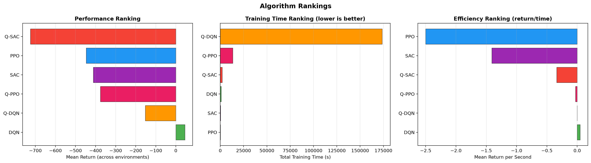 | 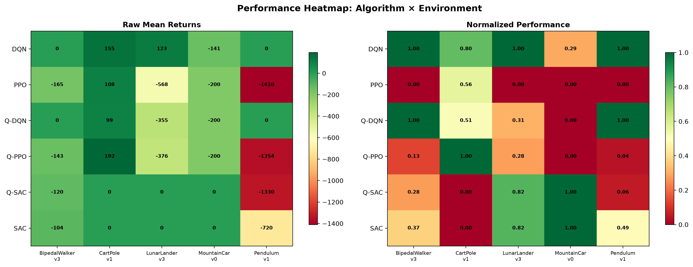 |

| Complexity Scaling Analysis | Area Under Learning Curve (AULC) |
|:---:|:---:|
| 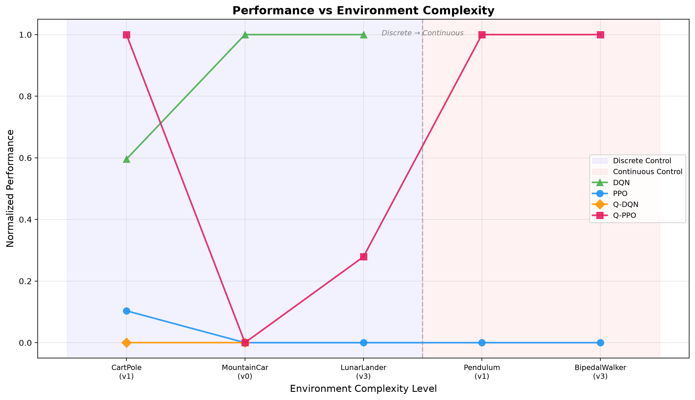 | 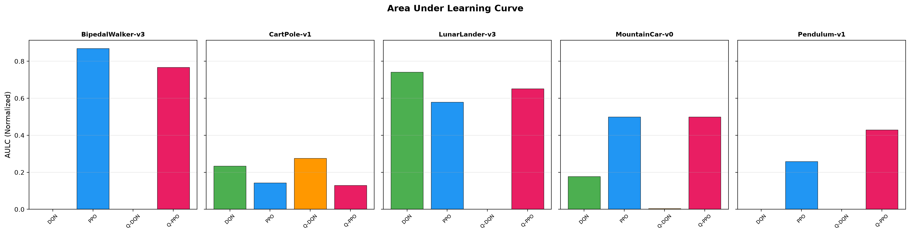 |

| Quantum Gradient Dynamics | Quantum Resource Utilization |
|:---:|:---:|
| 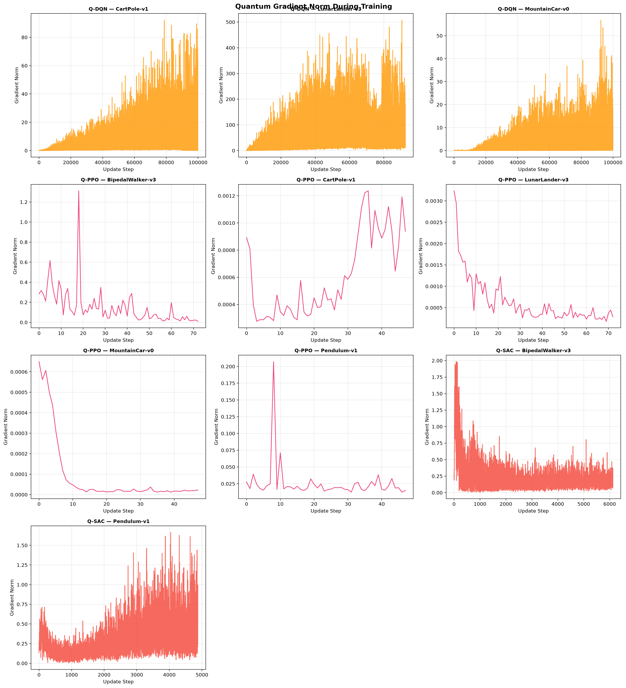 | 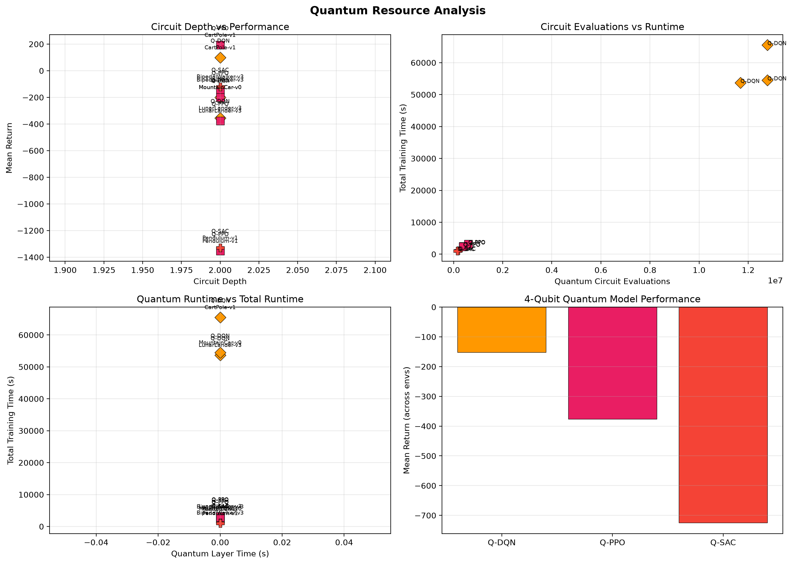 |

| Runtime vs Performance Pareto Frontier | Wall-Clock Training Overhead Heatmap |
|:---:|:---:|
| 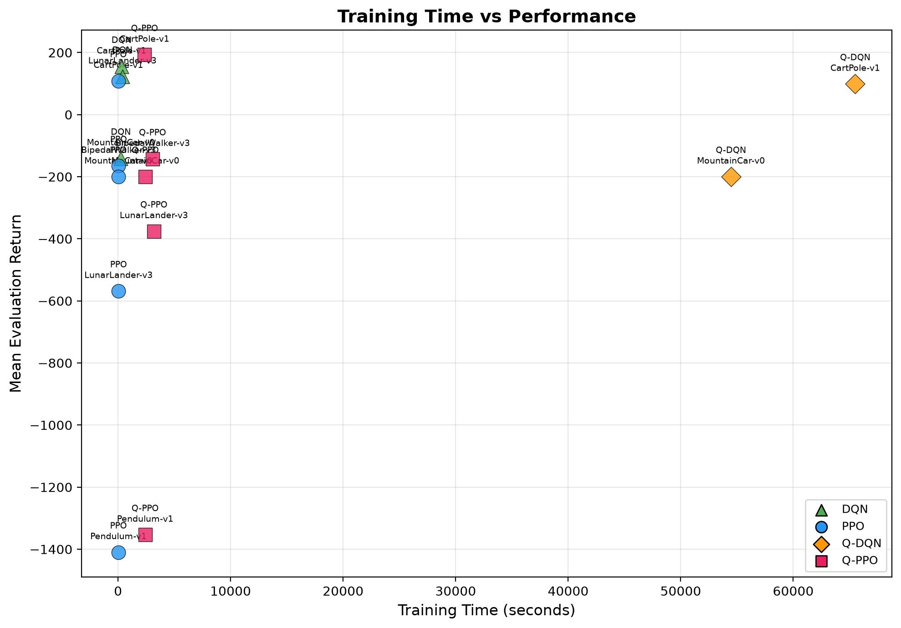 | 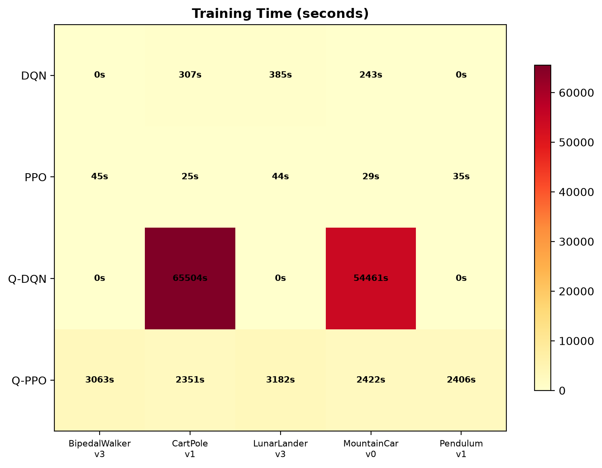 |

### Environment Complexity & Parameter Allocation Profile

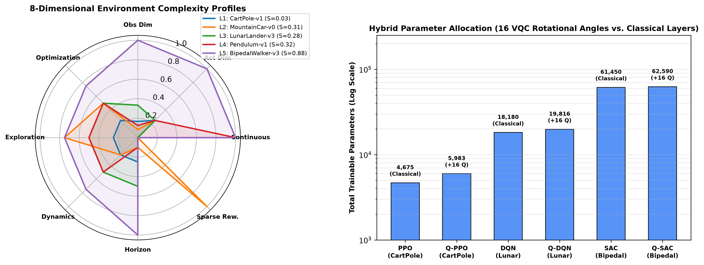

---

## ⚙️ Installation & Setup

### Prerequisites

- Python **3.10** or higher (tested up to Python 3.14)
- CPU (Multi-core) or CUDA-enabled GPU (optional, for PyTorch tensor acceleration)

### 1. Environment Setup

```bash
# Clone the repository
git clone https://github.com/Shr-i-ram/Quantum-Reinforcement-Learning-Benchmark.git
cd Quantum-Reinforcement-Learning-Benchmark

# Create virtual environment
python -m venv .venv

# Activate environment:
# On Windows PowerShell:
.venv\Scripts\Activate.ps1
# On Linux / macOS:
source .venv/bin/activate
```

### 2. Dependency Installation

```bash
# Core requirements (PennyLane, PyTorch, Gymnasium, Box2D, Pandas, Matplotlib)
pip install -r requirements.txt

# Or install as an editable package
pip install -e .
```

*Note for Windows users*: If Box2D requires compilation, install `gymnasium[box2d]` or ensure Microsoft Visual C++ Build Tools are installed.

---

## 🏃 One-Shot Benchmark Execution

To execute the entire end-to-end benchmark workflow through a single command:

```bash
python run_experiment.py
```

The runner performs:
1. **Software Dependency Validation**: Verifies PyTorch, PennyLane, Gymnasium, and PennyLane Lightning-Qubit simulator.
2. **Environment Validation**: Validates CartPole, MountainCar, LunarLander, Pendulum, and BipedalWalker.
3. **Complexity Analysis**: Computes empirical observation and dynamics complexity rankings.
4. **Resumable Training Matrix**: Checks existing results in `results/data/`, loads completed runs, and trains any remaining or interrupted models from their latest checkpoint.
5. **Deterministic Evaluation**: Evaluates all policies over 20 independent episodes per agent.
6. **Cross-Experiment Metric Computation**: Computes AULC, sample efficiency, stability, and runtime trade-offs.
7. **Visualization Generation**: Exports all 11 figure suites in PNG and PDF formats to `results/figures/`.
8. **Final Research Report**: Prints comprehensive research summaries and comparisons.

---

## 💾 Checkpointing, Recovery & Resumption

Checkpointing is fully automated and safe against unexpected interruptions:

- **Locations**: Checkpoints are stored in [`quantum_rl_benchmark/results/checkpoints/`](quantum_rl_benchmark/results/checkpoints/):
  - `<algo>_<env>_latest.pt`: Active training state saved at periodic intervals and upon graceful interrupt.
  - `<algo>_<env>_best.pt`: Checkpoint achieving the highest evaluation return.
  - `<algo>_<env>_step<N>.pt`: Rolling periodic checkpoints.
- **Payload Contents**: Model network state dict, optimizer state dict, random seed, step count, episode count, training history, and quantum circuit configuration.
- **Resumption Behavior**: If an experiment is interrupted, re-running `python run_experiment.py` detects the checkpoint, restores weights, and continues training from the exact environment step without starting over.

---

## 🔍 Evaluating Existing Checkpoints

To evaluate any existing trained checkpoint without re-running training:

```python
import torch
from quantum_rl_benchmark.training.trainer import Trainer
from quantum_rl_benchmark.config.settings import get_default_config, ENVIRONMENTS

config = get_default_config()
trainer = Trainer(config)

# Load trained agent
agent = trainer._load_agent("Q-PPO", "quantum_rl_benchmark/results/checkpoints/Q-PPO_CartPole-v1_latest.pt")

# Evaluate deterministically over 20 episodes
eval_metrics = trainer._evaluate(agent, "CartPole-v1", ENVIRONMENTS["CartPole-v1"], ENVIRONMENTS, n_episodes=20)
print(f"Mean Return: {eval_metrics['mean_return']:.2f} +/- {eval_metrics['std_return']:.2f}")
```

---

## 🎥 Agent Simulation Videos & Visualizations

The project includes an interactive visualization and video recording suite in [`visualize_agent.py`](visualize_agent.py). It captures full rollout episodes of trained policies with a live HUD telemetry overlay (Step count, Action, Instantaneous Reward, Cumulative Return) and exports smooth 30 FPS animated videos (`.gif`) viewable in all browsers and viewers.

### 🎬 Visual Previews of Trained Policies

| Q-PPO on CartPole-v1 (Return: 192.5) | DQN on LunarLander-v3 (Return: 122.5) |
|:---:|:---:|
| 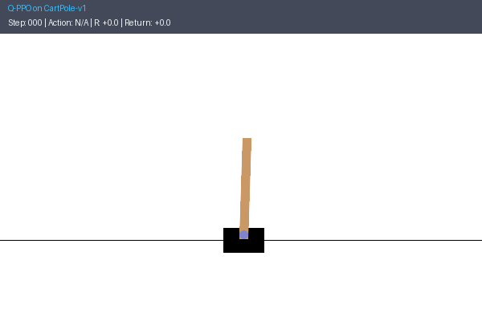 | 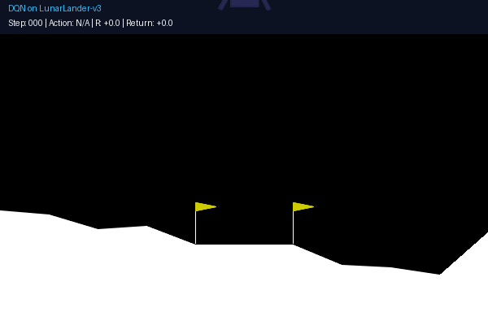 |

| Q-SAC on Pendulum-v1 (Continuous Torque) | SAC on BipedalWalker-v3 (4-DoF Bipedal) |
|:---:|:---:|
| 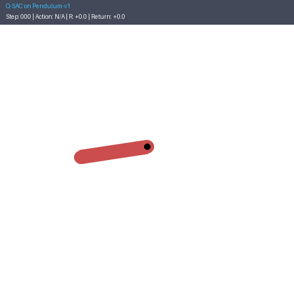 | 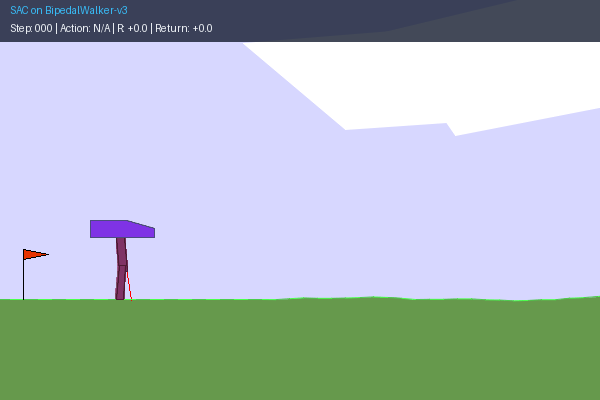 |

### 🖼️ Composite Rollout Galleries (Classical vs. Quantum & Full 20-Experiment Matrix)

| Classical vs. Quantum Policy Rollout Comparison (10 Panels) | Complete 20-Experiment Simulation Gallery (4×5 Grid) |
|:---:|:---:|
| 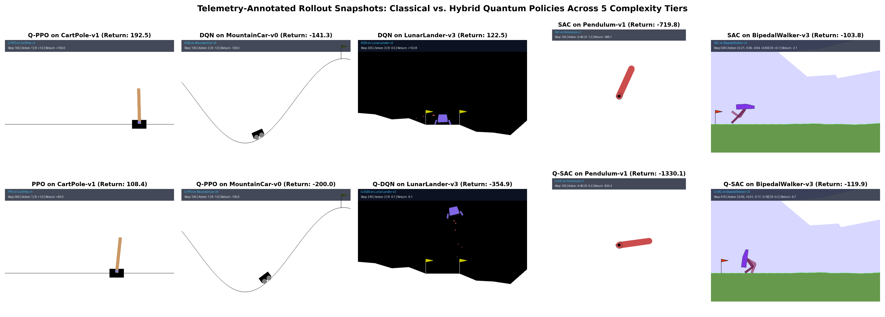 | 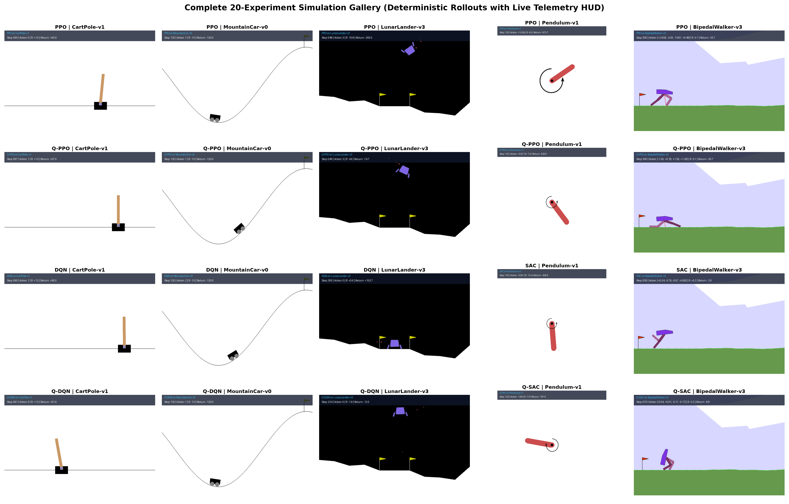 |

### Generate Videos for All 20 Viable Experiments

To batch-generate simulation videos for all 20 viable model-environment combinations in a single pass:

```bash
python visualize_agent.py --all
```

All 20 videos are saved to [`quantum_rl_benchmark/results/videos/`](quantum_rl_benchmark/results/videos/):

| Environment | Action Space | Viable Simulated Models |
|:---|:---:|:---|
| `CartPole-v1` | Discrete ($|\mathcal{A}|=2$) | `PPO`, `Q-PPO`, `DQN`, `Q-DQN` |
| `MountainCar-v0` | Discrete ($|\mathcal{A}|=3$) | `PPO`, `Q-PPO`, `DQN`, `Q-DQN` |
| `LunarLander-v3` | Discrete ($|\mathcal{A}|=4$) | `PPO`, `Q-PPO`, `DQN`, `Q-DQN` |
| `Pendulum-v1` | Continuous ($\mathcal{A}=[-2, 2]^1$) | `PPO`, `Q-PPO`, `SAC`, `Q-SAC` |
| `BipedalWalker-v3` | Continuous ($\mathcal{A}=[-1, 1]^4$) | `PPO`, `Q-PPO`, `SAC`, `Q-SAC` |

### Custom Simulations & Live Interactive Window

```bash
# Record a specific trained model with custom step budget
python visualize_agent.py --algo Q-PPO --env CartPole-v1 --max-steps 500

# Continuous control simulation (e.g. Q-SAC on Pendulum)
python visualize_agent.py --algo Q-SAC --env Pendulum-v1

# Watch an agent in a live interactive window (requires local GUI display)
python visualize_agent.py --algo DQN --env MountainCar-v0 --live
```

---

## 📐 Metric Definitions & Normalization Methods

- **Mean / Median / Best Return**: Undiscounted cumulative episode reward $\sum_t r_t$ averaged across 20 deterministic evaluation rollouts.
- **Area Under the Learning Curve (AULC)**: Normalized integral of the learning trajectory over environment steps:
  $$\text{AULC} = \frac{1}{T} \int_0^T \frac{\bar{R}(t) - R_{\min}}{R_{\max} - R_{\min}} dt$$
  where $\bar{R}(t)$ is the 50-episode moving average reward, computed via trapezoidal integration.
- **Sample Efficiency (Steps to Threshold)**: Environment steps required for the moving average reward to cross the designated solved threshold ($475.0$ for CartPole, $-110.0$ for MountainCar, $200.0$ for LunarLander, $-200.0$ for Pendulum, $300.0$ for BipedalWalker).
- **Training Stability**: Coefficient of variation ($\text{CV} = \sigma / |\mu|$) and interquartile range (IQR) over moving average rewards during training.
- **Cross-Environment Normalization**: For performance heatmaps and complexity scaling, returns are normalized per environment:
  $$R_{\text{norm}} = \frac{R - R_{\text{random}}}{R_{\text{target}} - R_{\text{random}}}$$

---

## ⚖️ Limitations & Scientific Honesty

In keeping with rigorous scientific standards, the following disclosures must be considered when interpreting benchmark findings:

1. **Single Random Seed**: All experiments were conducted using seed `42`. While within-run variance (IQR, CV, standard deviations) was tracked across evaluation rollouts, cross-seed confidence intervals and hypothesis testing cannot be inferred without multiple random seeds.
2. **Configuration Regime Differences**: To ensure practical completion within available computational budgets, the five remaining experiments (`Q-DQN LunarLander`, `SAC Pendulum`, `Q-SAC Pendulum`, `SAC BipedalWalker`, `Q-SAC BipedalWalker`) utilized optimized training frequencies, compact networks, and modified step budgets. Direct sample-efficiency comparisons across different regimes must account for these budgetary and architectural differences.
3. **Classical Simulation of Quantum Hardware**: Quantum circuits were simulated classically via state-vector simulation (`lightning.qubit`). Physical quantum phenomena such as coherent gate noise, decoherence, readout error, and circuit compilation topology were not present.
4. **Four-Qubit Information Bottleneck**: State spaces with observation dimension $d > 4$ (LunarLander $d=8$, BipedalWalker $d=24$) required classical linear projection to fit into 4 qubits. Performance on high-dimensional tasks reflects both the quantum ansatz and the classical compression bottleneck.

---

## 📁 Repository Structure

```tree
Quantum-Reinforcement-Learning-Benchmark/
├── .gitattributes                          # Cross-platform line endings and binary spec
├── .gitignore                              # Clean ignore patterns (venv, checkpoints, LaTeX build)
├── DEMO_GUIDE.md                           # University review presentation sequence & setup guide
├── IEEE_Quantum_RL_Benchmark_Paper.pdf     # Compiled 11-page IEEE Conference Paper (PDF)
├── LICENSE                                 # MIT Open-Source License
├── PROJECT_AUDIT.md                        # Comprehensive pre-implementation repository audit
├── README.md                               # Project documentation & benchmark overview
├── RESULTS_SUMMARY.md                      # Complete empirical findings, baselines & ablations
├── app.py                                  # Interactive Streamlit Live Demonstration Platform
├── pyproject.toml                          # PEP 517/621 build and installation metadata
├── requirements.txt                        # Core runtime dependencies (including Streamlit & Plotly)
├── requirements-dev.txt                    # Development, testing, and formatting tools
├── run_experiment.py                       # Top-level one-shot benchmark entrypoint
├── visualize_agent.py                      # Simulation recording & live HUD visualizer
├── paper/                                  # IEEE Conference Paper LaTeX source & build
│   ├── ieee_quantum_rl_benchmark.tex       # Full IEEEtran LaTeX manuscript with TikZ diagrams
│   └── ieee_quantum_rl_benchmark.pdf       # Compiled IEEE Conference Paper PDF
├── scripts/                                # Demonstration training & verification utilities
│   ├── audit_suite.py                      # Automated checkpoint loading & gradient audit
│   └── train_demonstration_agent.py        # Verified CartPole 500-return reference trainer
├── tests/                                  # Integration & validation test suite
│   └── test_demo_and_pipeline.py           # End-to-end environment, model & demo tests
└── quantum_rl_benchmark/                   # Main benchmark package
    ├── __init__.py
    ├── orchestrator.py                     # Pipeline orchestration and validation suite
    ├── config/
    │   ├── __init__.py
    │   └── settings.py                     # Hyperparameters, budgets & environment matrix
    ├── demo/                               # Interactive Live Demo application modules
    │   ├── __init__.py
    │   ├── engine.py                       # Stepping engine, HUD renderer & action inspector
    │   ├── styles.py                       # Dark research-console CSS theme
    │   ├── training_worker.py              # Background asynchronous training manager
    │   └── views/                          # Mission control, playground, arena, lab, tour
    ├── environments/
    │   ├── __init__.py
    │   ├── complexity.py                   # Complexity metric calculations (entropy, dim)
    │   └── manager.py                      # Gymnasium environment builder & wrappers
    ├── models/
    │   ├── __init__.py
    │   ├── classical/                      # Classical RL agents (DQN, PPO, SAC)
    │   └── quantum/                        # Quantum & Hybrid VQC agents (Q-DQN, Q-PPO, Q-SAC)
    │       ├── circuit.py                  # Differentiable 4-qubit VQC layer with broadcasting
    │       ├── q_dqn.py                    # Quantum DQN
    │       ├── q_ppo.py                    # Quantum PPO
    │       └── q_sac.py                    # Quantum SAC
    ├── training/
    │   ├── __init__.py
    │   └── trainer.py                      # Resumable training loop, logging & checkpointing
    ├── evaluation/
    │   ├── __init__.py
    │   ├── ablations.py                    # Depth, width & classical control ablation suite
    │   ├── baselines.py                    # Random & heuristic baseline policies
    │   ├── evaluator.py                    # Deterministic evaluation & rollout metrics
    │   └── robustness.py                   # Multi-seed & observation noise perturbation tests
    ├── metrics/
    │   ├── __init__.py
    │   └── metrics.py                      # AULC, sample efficiency & stability statistics
    ├── visualization/
    │   ├── __init__.py
    │   └── plots.py                        # Publication-quality plotting suite (PNG & PDF)
    └── results/                            # Benchmark artifacts
        ├── checkpoints/                    # Model weights (.pt) including demonstration model
        ├── data/                           # Evaluated metrics JSON and system info
        ├── experiment_registry.json        # Central manifest of all 20 runs + baselines + ablations
        ├── figures/                        # High-resolution PNG & PDF visualizations
        ├── logs/                           # Per-run progress logs
        └── videos/                         # 30 FPS HUD animated simulation recordings (.gif)
```

---

## 📄 License & Citation

This project is licensed under the [MIT License](LICENSE).

```bibtex
@inproceedings{narayanan2026quantum_rl_benchmark,
  author    = {Narayanan, Shriram and Paulraj, Evelyn Maria and P, Koppesh},
  title     = {Empirical Evaluation of 4-Qubit Variational Quantum Reinforcement Learning Across Multi-Tier Discrete and Continuous Gymnasium Environments},
  booktitle = {IEEE Conference Proceedings},
  year      = {2026},
  url       = {https://github.com/Shr-i-ram/Quantum-Reinforcement-Learning-Benchmark}
}
```
